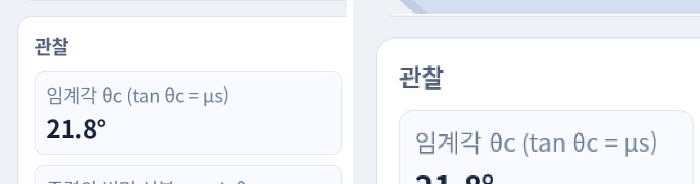

# low 단계 UI 해상도 결정

- 일시: 2026-10-21, 기기 SM-P200(1200×1920, Mali-G71 MP2, Android 11), 앱 `org.openphysics.lab3d` release APK
- 계약: [Phase 1 Task 2a](../../../docs/3d-phase1/README.md#task-2a-상세) "low에서도 UI는 원본 해상도로 선명하게 그린다(3D만 낮은 해상도). 방식은 실측으로 정한다."
- 원본 로그: [`spikes/bench/results/phase1-task2a/variants/`](../../../spikes/bench/results/phase1-task2a/variants/) (`<이름>.log` OPBENCH+OPPERF, `<이름>.clk` "Mali 클럭(kHz) AP 온도(°C)"). 표는 `spikes/bench/variant-summary.mjs`로 만들었다.

## 결정

**UI는 원본 해상도(루트 뷰포트 `canvas_items` 스트레치), 3D는 SubViewport에서 화면 픽셀의 일부로 그려 TextureRect로 늘린다(`ui_mode=native`). low의 3D는 75 % + MSAA 2x(`view_scale` 0.75, 2026-10-24, 7절)이고, Task 2a 결정 당시에는 45 %(`view_scale` 0.45, MSAA 없음)였다.** 함께 지키는 규칙: 전체 화면을 덮는 2D 레이어를 두지 않는다. 배경은 clear color로 칠하고, 패널 시트도 바탕을 칠하지 않는다.

- (Task 2a 측정, 3D 45 %) 최종 빌드에서 low 60.0 fps(아래 3절), Task 1 방식(루트 전체 540)과 fps가 같고 UI는 원본 해상도로 선명하다.
- Task 1 방식보다 GPU 여유는 적다(평균 GPU 클럭 411 vs 343 MHz). 패널에 전체 화면 레이어를 하나 더 얹으면 다시 47 fps로 떨어진다(2절).

## 1. 비교한 방식

| `ui_mode` | 루트 뷰포트(UI) | 3D 뷰 | 비고 |
|---|---|---|---|
| `native` | 원본 해상도(1200×1920) | SubViewport, 화면 픽셀 × `view_scale` | 채택 |
| `root` | 짧은 변 540(Task 1 low와 같음), 화면에 확대 | SubViewport, 루트 픽셀 크기 그대로 | UI까지 흐리다. UI 배치 기준도 540이라 버튼·글자가 1.33배 커진다 |
| `scale3d` | 원본 해상도 | SubViewport는 원본 크기, `scaling_3d_scale` 0.45 | Task 1에서 Mobile 렌더러의 3D 배율이 출력 해상도 고정 비용을 남긴 것과 같은 방식 |

세 방식 모두 3D 장면·조명·그림자(끔)는 같고, 3D 뷰는 화면의 위쪽 약 46%다.

## 2. 처음 구현에서 드러난 비용

첫 구현(`native`)은 47 fps였다. 패널과 3D를 하나씩 빼서 갈랐다(각 15초 대기 후 30초, 각도 20°, 패널 맨 위, 상자 정지).

| 변형 | FPS | p95 ms | GPU MHz | 드로우콜 |
|---|---|---|---|---|
| `a-native` 첫 구현 | 47.2 | 23.9 | 450 | 56 |
| `a-root` Task 1 방식 | 60.0 | 19.4 | 343 | 48 |
| `a-scale3d` | 34.7 | 31.7 | 450 | 56 |
| `a-nopanel` 패널 숨김 | 60.0 | 18.7 | 450 | 28 |
| `a-no3d` 3D 갱신 끔 | 54.5 | 20.3 | 450 | 51 |
| `a-norefresh` 패널 10 Hz 갱신 끔 | 47.6 | 22.3 | 450 | 56 |
| `b-bg0` 전체 화면 배경 사각형 → clear color | 60.0 | 18.9 | 443 | 55 |
| `b-aa0` StyleBox 안티에일리어싱 끔 | 47.9 | 22.0 | 450 | 56 |
| `b-cards0` 패널 카드 바탕 전부 끔 | 60.0 | 18.8 | 450 | 61 |
| `b-all` 위 세 가지 모두 | 60.0 | 19.2 | 357 | 60 |
| `b-overlays0` 3D 위 버튼·안내 숨김 | 48.9 | 22.0 | 450 | 41 |

- 비용은 CPU(패널 갱신, 드로우콜)가 아니라 원본 해상도에서 겹쳐 칠하는 픽셀 양(fill rate)이다. 패널 갱신을 꺼도, 안티에일리어싱을 꺼도, 3D 위 버튼을 숨겨도 그대로였고, 전체 화면 레이어 하나(배경 사각형 2.3 Mpx)를 빼자 60 fps가 됐다.
- 그래서 배경을 clear color로 바꾸고 패널 시트(`SideSheet`)의 바탕 칠을 없앴다. 카드·타일 바탕은 남겼다.
- `scale3d`는 3D 버퍼를 줄여도 SubViewport가 원본 크기라 후처리·블릿 비용이 남는다. Compatibility 렌더러에서도 Task 1(Mobile 렌더러)과 같은 결과다.

## 3. 최종 빌드 비교

배경 수정 뒤 같은 빌드로 다시 쟀다. 조건은 실기기 측정과 같다: low, 세로, 패널을 관찰값·그래프 위치로 스크롤, 각도 30°, 4초마다 상자를 다시 놓음(물리·관찰값·그래프 계속 갱신). 앱 시작 후 20초 대기, 40초 기록.

| 변형 | FPS | p95 ms | GPU MHz | 물리 ms | 렌더 CPU ms | 드로우콜 |
|---|---|---|---|---|---|---|
| `c-native` 채택안(3D 0.45) | 60.0 | 19.8 | 411 | 3.5 | 4.4 | 132 |
| `c-root` Task 1 방식 | 60.0 | 19.7 | 343 | 3.9 | 2.9 | 84 |
| `c-scale3d` | 45.9 | 25.4 | 450 | 4.0 | 4.3 | 132 |
| `c-native-vs60` 3D 0.6 | 60.0 | 19.3 | 450 | 3.5 | 4.4 | 132 |
| `c-native-vs100` 3D 1.0 | 41.9 | 37.9 | 450 | 5.2 | 6.2 | 132 |

- Compatibility 렌더러는 GPU 타임스탬프가 없어 GPU ms 대신 Mali 클럭으로 여유를 본다. 부하가 가벼우면 DVFS가 343 MHz까지 내려간다(Task 1 2절).
- 3D 0.6도 60 fps지만 GPU가 450 MHz에 붙어 여유가 없다. 지속 측정의 열 상태를 생각해 0.45를 유지했다.
- 측정 기준 절차(90초 × 3회 + 10분)의 결과는 [측정 결과](../../../spikes/bench/results/phase1-task2a/README.md)에 있다.

## 4. 선명도

같은 화면(관찰 카드)을 두 방식으로 찍어 원본 픽셀 그대로 잘랐다. 왼쪽 `native`, 오른쪽 `root`. `root`는 540 기준으로 그린 뒤 2.2배 늘려 글자 가장자리가 흐리고, 배치 기준이 달라 요소가 1.33배 크다.

## 5. 남은 위험

- 원본 해상도 2D는 겹쳐 칠하는 면적에 민감하다. 패널에 전체 화면 크기 반투명 레이어(모달 배경, 큰 그림자 등)를 더하면 low 60 fps가 깨질 수 있다. 새 화면을 만들 때 `bench_device.sh`로 다시 확인한다.
- 이 결론은 SM-P200(1200×1920) 기준이다. 더 높은 해상도의 저가 기기에서는 UI 비용이 화면 픽셀 수에 비례해 늘어난다.

## 6. 가로 전용 레이아웃 (Task 2d)

2026-10-23 앱을 가로 전용으로 바꾸고 실험 화면을 3D 전체 + 핵심 관찰값 카드 + 오른쪽 사이드바로 바꿨다([앱 README "레이아웃과 해상도"](../README.md#레이아웃과-해상도)). 위 결정(UI 원본 해상도, 3D만 0.45배 SubViewport, 전체 화면 2D 레이어 금지)은 그대로 지킨다.

- **사이드바는 3D 위에 겹치지 않고, 열리면 3D 뷰가 남은 영역으로 줄어든다.** 겹치면 사이드바 영역(태블릿 783×1200 px, 0.94 Mpx)을 3D 위에 다시 칠해야 하고 글을 읽으려면 바탕까지 칠해야 해 2절의 "전체 화면 레이어" 비용에 가까워진다. 줄이면 사이드바는 지금처럼 바탕 없이 clear color 위에 카드만 칠하고(태블릿 열림 = Task 2a 가로 배치와 같은 면적), 3D SubViewport도 작아진다. 장면의 물체가 사이드바 뒤에 가리지도 않는다.
- 사이드바 애니메이션은 사이드바 노드의 위치만 옮긴다. 3D 뷰 크기는 열 때·닫을 때 한 번씩만 바꾼다(SubViewport 재할당이 슬라이드 프레임마다 일어나지 않게).
- 3D 위에 늘 있는 2D는 제목줄, 오른쪽 위 버튼 둘, 핵심 카드 2~3개(각 200×약 80 단위), 액션 버튼, 처음에만 4초 보이는 조작 안내 한 줄뿐이다(합쳐 화면의 약 15 %). 반투명 막·큰 그림자는 없다.
- 측정(SM-P200 low, 90초 × 1회, `--auto-drag=4`): 사이드바 닫힘 빗면 59.81·충돌 59.78·진자 59.80 fps, 열림 59.79·59.81·59.77 fps. 닫힘은 3D가 화면 전체(864×540 px 버퍼)로 커지지만 2D 드로우콜이 33 안팎으로 줄어(열림 67–106) fps가 같다. [Task 2d 결과](../../../spikes/bench/results/phase1-task2d/README.md)

## 7. low 3D 해상도 상향 (2026-10-24)

태블릿에서 3D가 계단처럼 깨져 보인다는 사용자 반응으로 low의 3D를 **0.45배 MSAA 없음(짧은 변 540 px) → 0.75배 + MSAA 2x(900 px)**로 올렸다. UI(원본 해상도)·확대 필터(쌍선형)·전체 화면 2D 레이어 금지 규칙은 그대로다.

- SM-P200 90초 × 1회(끌기 재생): 던지기 59.74·자유 낙하 59.73 fps, 던지기 10분 저하 0.1 %. 원본 해상도(1.0)는 MSAA를 꺼도 던지기 59.47 fps·33 ms 넘는 프레임 28개로 미달, 0.85 + MSAA는 GPU 712 MHz로 여유가 적어 뺐다.
- 궤도 끌기 재생은 58.84 fps로 미달이다(기존 0.45에서도 59.50 경계, 놓기만 59.66). 끄는 동안의 CPU 스파이크로 추정한다.
- 표·원본: [low 선명도 결과](../../../spikes/bench/results/phase1-low-sharp/README.md)
