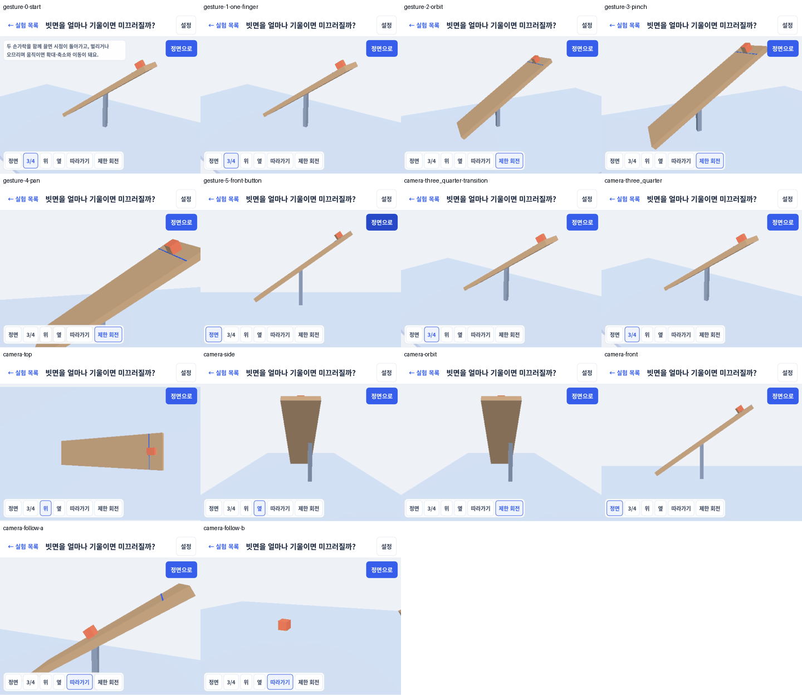
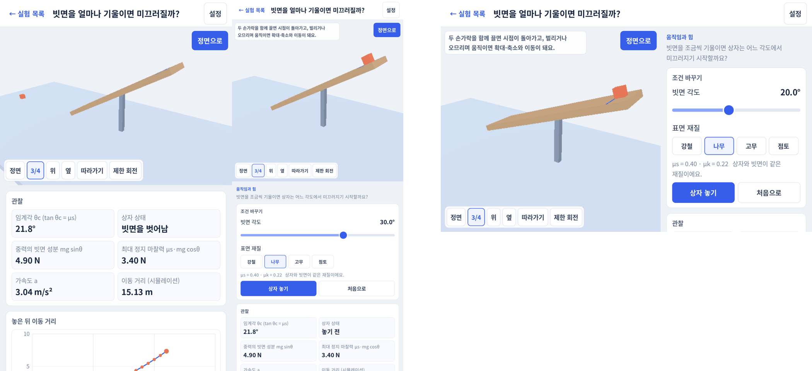

# Phase 1 Task 2a 결과 — 3D 앱 셸 실기기 확인

- 기기: SM-P200 (Galaxy Tab A 8.0 2019, Exynos 7904 / Mali-G71 MP2, Android 11, 1200×1920, 60 Hz) — 하한 기기
- 일시: 2026-10-21 20:30–22:00
- 빌드: `apps/lab3d` release APK(디버그 키스토어), Godot 4.7.2 + Jolt. fps 측정은 커밋 `2112e88`, 스크린샷은 `dbc0e31`(제스처 끝처리만 다름, 렌더링 경로 같음)
- 계약: [Phase 1 README의 Task 2a 상세](../../../../docs/3d-phase1/README.md#task-2a-상세)
- 조건: USB 케이블 연결(adb), 충전 중, 배터리 100%, 밝기·비행기 모드는 바꾸지 않았다. Task 1 측정과 같은 조건이다(측정 기준 2절의 무선 연결·케이블 분리는 지키지 않았다).

## 요약

| 판정 항목 | 결과 | 근거 |
|---|---|---|
| SM-P200 low에서 빗면 실험 60 fps(측정 기준 절차, 패널·그래프 표시) | 충족 — 평균 59.8 fps, 10분 저하 0.0% | 1절 |
| 카메라 모드·"정면으로"·제스처가 실기기에서 동작 | 충족 | 2절, `screenshots/camera-*.png`, `screenshots/gesture-*.png`, `gesture-log.txt` |
| 폰 세로·태블릿 가로 레이아웃, low에서 UI 원본 해상도 | 충족 | 3절, `screenshots/layout-*.png`, [UI 해상도 결정](../../../../apps/lab3d/docs/ui-resolution.md) |
| 헤드리스 테스트(parity, 빗면 공식 일치) | 충족 | `apps/lab3d/tools/build.sh test` RESULT: PASS, 루트 `npm test` 통과 |

- fps: 90초 × 3회 평균 59.8 fps, 10분 지속 분당 59.8 fps 유지, PSS 156 → 160 MB. Task 1의 low S3(59.8 fps, PSS 150 MB)와 같은 수준이다. 측정 기준 1절의 1% low(≥ 50)·p95(≤ 18 ms)는 각각 37.7 fps·19.5 ms로 미달이다. Task 1 low와 같은 패턴으로, Task 1 7절은 수집기의 10초 간격 `dumpsys meminfo`가 원인이라고 봤고, 검증 단계에서 비교 측정으로 확인했다(1-1절).
- UI 해상도: UI는 원본 해상도, 3D만 SubViewport 0.45로 그린다. 첫 구현은 47 fps였고, 원인은 원본 해상도에서 겹쳐 칠하는 면적(전체 화면 배경 레이어)이었다. 배경을 clear color로 바꿔 60 fps가 됐다. 근거는 [UI 해상도 결정](../../../../apps/lab3d/docs/ui-resolution.md).
- 측정 뒤 바뀐 코드: 제스처 끝처리(`dbc0e31`), 상자가 빗면을 벗어난 뒤 "이동 거리" 표시를 빗면 길이(7.5 m)에서 멈춤(표시만). 렌더링 경로는 바뀌지 않아 다시 재지 않았다.

## 1. low 단계 fps (측정 기준 절차)

`apps/lab3d/tools/bench_device.sh low 3 90 60`로 쟀다.

- 셰이더 캐시 실행 1회(20초) → 회차마다 앱 재시작, 30초 워밍업, 90초 기록 × 3회(회차 사이 60초 휴식) → 재시작, 30초 워밍업, 600초 지속 기록.
- 화면 상태: 세로, 위쪽 3D 뷰 + 아래 패널을 관찰값·그래프 위치로 스크롤(`--scroll-to=observations`), 빗면 30°·나무, 4초마다 상자를 다시 놓는다(`--auto-release=4`). 물리·관찰값 6개·그래프가 계속 바뀐다.
- OPBENCH 장면 이름은 `S3`, 후보 이름은 `lab3d-low`. 표는 `node spikes/bench/summarize.mjs spikes/bench/results/phase1-task2a`로 만들었다(앞 30초 제외).
- `gpu-clock-low.log`: 5초마다 "유닉스 시각 Mali 클럭(kHz) AP 온도(°C)".

| 후보 | 장면 | 평균 FPS | 1% low* | p95 ms | 최고 온도 °C | PSS MB | 10분 저하 | 10분 최고 °C / PSS MB |
|---|---|---|---|---|---|---|---|---|
| lab3d-low | S3 | 59.8 | 37.7 | 19.5 | 30.6 | 160 | 0.0% | 29.9 / 160 |

\* 1% low는 초당 p99 프레임 시간 평균의 역수로 근사한다(측정 기준 결과표와 같다).

| 회차 | 기록 초(30초 이후) | 최저 초당 fps | 33 ms 넘는 프레임 |
|---|---|---|---|
| 1 | 93 | 53.9 | 8 |
| 2 | 92 | 56.2 | 8 |
| 3 | 93 | 56.8 | 8 |
| 10분 | 603 | 54.4 | 59 |

10분 지속의 분당 평균 fps: 0분 59.8, 2분 59.8, 4분 59.8, 6분 59.8, 8분 59.8, 10분 60.1(마지막 일부 구간).

Mali GPU 클럭(전 구간 5초 표본 238개): 450 MHz 74%, 343 MHz 26%, 545·676 MHz 각 1개. AP 최고 44.5 °C. 참고로 Task 1 low 10분은 676 MHz 23%, 545 MHz 15%, 450 MHz 55%, 343 MHz 7%였다(장면이 달라 직접 비교하지 않는다).

### 1-1. 수집기 영향 비교 (검증 단계, 2026-10-21)

같은 APK·같은 화면 상태(low, 30°, 4초마다 다시 놓기)에서 `collect.sh`가 앱의 `dumpsys meminfo`를 부르지 않게(존재하지 않는 패키지 이름을 넘김) 90초를 쟀다. 2회 중 1회는 adb 서버 재시작으로 logcat이 끊겨 버리고, 유효한 1회만 쓴다. 원본: [`collector-ab/`](./collector-ab/).

| 조건 | 평균 FPS | 1% low* | p95 ms | 33 ms 넘는 프레임(30초 이후) | 초당 p99 최댓값 |
|---|---|---|---|---|---|
| 정식 측정(메모리 조회 10초 간격), 3회 | 59.8 | 37.7 | 19.5 | 회당 8개 | — |
| 메모리 조회 없음, 1회 | 60.0 | 48.4 | 19.0 | 0개 | 25.0 ms |

- 긴 프레임(33 ms 초과)은 수집기의 `dumpsys meminfo`가 만든다. 조회를 빼면 0개다.
- 그래도 1% low 48.4 fps·p95 19.0 ms로 측정 기준(≥ 50, ≤ 18 ms)에 조금 못 미친다. 멈춤이 아니라 16.7 ms 주변의 프레임 간격 흔들림(초당 p95가 19–20 ms)이다. 기준을 바꿀지, 프레임 페이싱을 Task 2c 이후에 다룰지는 사용자 판단으로 남긴다.

## 2. 카메라 모드·"정면으로"·제스처

- 두 손가락 제스처는 `apps/lab3d/tools/device_gesture.py`로 재생했다. Android `hid` 명령으로 2점 가상 멀티터치 화면(HID 디지타이저)을 등록해 실제 입력 경로(커널 hid-multitouch → Android InputReader → Godot)로 들어간다. `adb shell input`은 한 손가락만 되고, 실제 터치스크린 노드(`/dev/input/event1`)에 쓰기는 SELinux가 막았다. 손으로 한 확인은 아니다.
- 모드 칩·"정면으로"·"상자 놓기"는 `adb shell input tap`으로 눌렀다.
- `gesture-log.txt`는 같은 순서를 임시 디버그 로그(`[DEBUG-GESTURE]`, 커밋 전 제거)를 넣은 빌드로 돌린 기록이다. 터치 위치는 UI 단위(1 단위 = 1.67 px), 카메라 값은 각 터치 시작·끝의 목표값이다.

| 순서 | 입력 | 결과(로그) | 스크린샷 |
|---|---|---|---|
| 1 | 시작(3/4 기본 시점) | yaw 35°, pitch −24°, 거리 11 | `gesture-0-start.png` |
| 2 | 빈 3D 뷰에서 한 손가락 가로 드래그 | 카메라 그대로(yaw 35°). 조작용 신호만 나간다 | `gesture-1-one-finger.png` |
| 3 | 두 손가락 함께 오른쪽 | `orbit`로 분류, yaw 35° → −22°, 모드 `제한 회전` | `gesture-2-orbit.png` |
| 4 | 두 손가락 벌리기 | `pinch`로 분류, 거리 11 → 8.7 | `gesture-3-pinch.png` |
| 5 | 조금 벌린 뒤 두 손가락 아래로 | `pinch`로 분류, 이동(pan) y +1.57, 거리 8.7 → 6.6 | `gesture-4-pan.png` |
| 6 | "정면으로" | 정면, 이동·확대 초기화 | `gesture-5-front-button.png` |
| 7 | 모드 칩 정면·3/4·위·옆·제한 회전 | 각 시점으로 약 0.4초에 걸쳐 이동(3/4 전환 중간 화면 포함) | `camera-*.png` |
| 8 | 따라가기 + 상자 놓기(35°) | 미끄러지는 상자를 따라가고, 빗면을 벗어나 떨어질 때도 따라간다 | `camera-follow-a.png`, `camera-follow-b.png` |

가상 장치의 벌리기에서 0번 손가락 좌표가 끝까지 가지 않는 현상이 있었다(Android가 보고한 손가락 떼기 위치가 시작점 근처). 확대는 동작했지만 확대량이 입력보다 작다. 실제 손가락 입력에서는 확인하지 못했다.

## 3. 레이아웃과 UI 선명도

| 화면 | 해상도 | 파일 |
|---|---|---|
| 태블릿 세로(SM-P200) — 3D 위, 패널 아래 | 1200×1920 | `layout-tablet-portrait.png`, `layout-tablet-portrait-observations.png` |
| 태블릿 가로(SM-P200) — 3D 왼쪽, 패널 오른쪽 | 1920×1200 | `layout-tablet-landscape.png` |
| 폰 세로 — `adb shell wm size 1080x2340`로 화면 크기만 바꿔 찍고 `wm size reset`으로 되돌렸다 | 1080×2340 | `layout-phone-portrait.png` |
| 실험 목록, 설정 | 1200×1920 | `screen-list.png`, `screen-settings.png` |
| UI 선명도: low에서 `native`(채택) vs `root`(Task 1 방식) 원본 픽셀 자름 | — | `ui-native-vs-root.png` |

모두 low 단계(Compatibility, 3D 0.45)다. 글자·버튼 가장자리는 원본 해상도로 그려지고, 3D 뷰만 낮은 해상도로 늘어나 보인다.

## 4. 파일

- `lab3d-low-S3-{1,2,3,sustained}.jsonl` / `.device.jsonl` / `.perf.jsonl`: OPBENCH, 기기 온도·PSS, OPPERF
- `gpu-clock-low.log`: Mali 클럭·AP 온도
- `variants/`: UI 해상도 방식 비교(`godot-variant.sh`), 해석은 [UI 해상도 결정](../../../../apps/lab3d/docs/ui-resolution.md)
- `screenshots/`: 위 2·3절
- `gesture-log.txt`: 2절 제스처 로그
