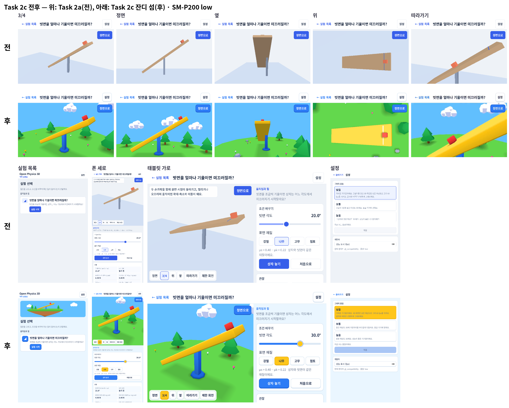
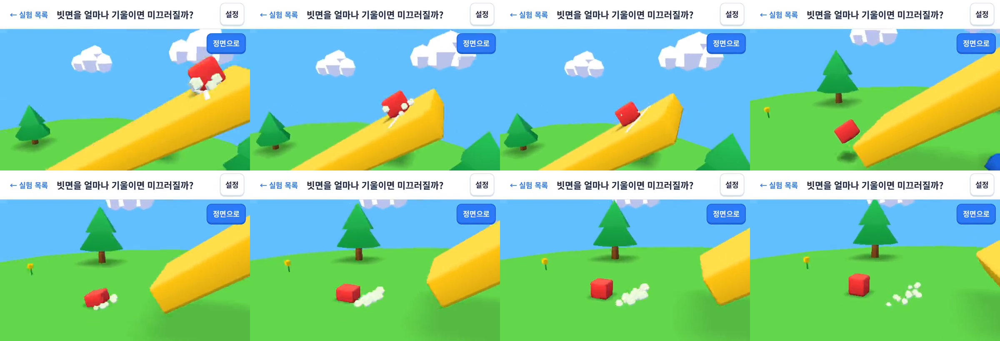
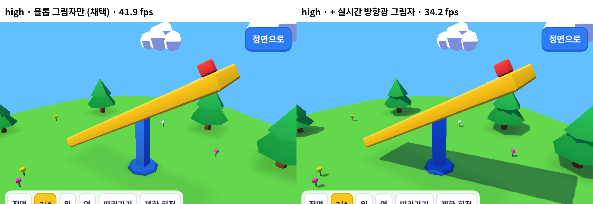

# Phase 1 Task 2c 결과 — 잔디 섬 스타일 확정과 실기기 확인

- 기기: SM-P200 (Galaxy Tab A 8.0 2019, Exynos 7904 / Mali-G71 MP2, Android 11, 1200×1920, 60 Hz) — 하한 기기
- 일시: 2026-10-22 07:20–07:55
- 빌드: `apps/lab3d` release APK(디버그 키스토어), Godot 4.7.2 + Jolt. fps 정식 측정은 커밋 `f9d351e`. 스크린샷은 그 뒤 카메라 착지 반응 폭(`CameraRig.NUDGE_SPEED` 1.1 → 2.4)만 바꾼 빌드(렌더링 경로 같음, 다시 재지 않음).
- 계약: [Phase 1 README의 Task 2c 상세](../../../../docs/3d-phase1/README.md#task-2c-상세). 시안 단계는 [mockups/](mockups/README.md), 스타일 기준은 [아트 디렉션](../../../../apps/lab3d/docs/art-direction.md).
- 조건: Task 2a와 같다. USB 연결(adb), 충전 중, 배터리 100%, 밝기·비행기 모드는 바꾸지 않았다(측정 기준 2절의 무선 연결·케이블 분리는 지키지 않음).

## 요약

| 판정 항목 | 결과 | 근거 |
|---|---|---|
| 사용자가 시안 중 하나를 고른다 | 충족 — B 잔디 섬(2026-10-22), 기본 카메라를 가깝게 | [mockups/](mockups/README.md), 2절 |
| SM-P200 low 빗면 60 fps(90초 × 3회, 10분 지속 1회) | 충족 — 평균 59.8 fps, 10분 저하 0.0% | 1절 |
| 공식 보정·표시 수치 테스트가 그대로 통과 | 충족 — `apps/lab3d/tools/build.sh test` RESULT: PASS, 루트 `npm test` 442개 통과. 아트가 물리·표시 값을 바꾸지 않음을 확인하는 테스트 추가 | 3절 |
| 스타일 가이드와 전후 스크린샷 | 충족 | [아트 디렉션](../../../../apps/lab3d/docs/art-direction.md), `before-after.png`, `screenshots/` |

## 1. low 단계 fps (측정 기준 절차)

`OPBENCH_RESULTS_DIR=spikes/bench/results/phase1-task2c apps/lab3d/tools/bench_device.sh low 3 90 60`. 화면 상태는 Task 2a 1절과 같다: 세로, 3D 뷰(기본 3/4) + 패널을 관찰값·그래프 위치로 스크롤, 빗면 30°·나무, 4초마다 다시 놓기(놓기·착지 연출과 먼지가 4초마다 나온다). 셰이더 캐시 1회 → 90초 × 3회(회차 사이 60초) → 600초 지속. 표는 `node spikes/bench/summarize.mjs spikes/bench/results/phase1-task2c`(앞 30초 제외).

| 후보 | 장면 | 평균 FPS | 1% low* | p95 ms | 최고 온도 °C | PSS MB | 10분 저하 | 10분 최고 °C / PSS MB |
|---|---|---|---|---|---|---|---|---|
| Task 2a (기준, [결과](../phase1-task2a/README.md)) | S3 | 59.8 | 37.7 | 19.5 | 30.6 | 160 | 0.0% | 29.9 / 160 |
| **Task 2c 잔디 섬** | S3 | **59.8** | 39.9 | 18.3 | 30.2 | 160 | **0.0%** | 30.7 / 161 |

\* 1% low는 초당 p99 프레임 시간 평균의 역수 근사(측정 기준 결과표와 같다).

| 회차 | 기록 초(30초 이후) | 최저 초당 fps | 33 ms 넘는 프레임 | 드로우콜 | 프리미티브 | 렌더 CPU ms | 물리 ms |
|---|---|---|---|---|---|---|---|
| Task 2a 1–3회 | 92–93 | 53.9–56.8 | 회당 8 | 132 | 12.4k | 4.39 | 3.6–3.7 |
| 2c 1 | 93 | 56.8 | 8 | 136 | 14.5k | 4.44 | 3.94 |
| 2c 2 | 93 | 56.8 | 8 | 136 | 14.5k | 4.42 | 3.73 |
| 2c 3 | 93 | 56.2 | 8 | 136 | 14.5k | 4.42 | 3.92 |
| 2c 10분 | 604 | 54.9 | 60 | 136 | 14.5k | 4.42 | 3.84 |

- 10분 지속의 분당 평균 fps: 0분 59.8, 2분 59.7, 4분 59.8, 6분 59.8, 8분 59.7, 10분 59.8.
- 1% low·p95는 측정 기준(≥ 50 fps, ≤ 18 ms)에 여전히 조금 못 미친다. 33 ms를 넘는 프레임이 회당 8개로 Task 2a와 똑같은 패턴이라, Task 2a 1-1절에서 확인한 수집기의 10초 간격 `dumpsys meminfo`가 만드는 몫으로 본다(조회를 빼면 0개였다). 스타일 변경으로 나빠지지 않았고 p95는 19.5 → 18.3 ms로 오히려 낮다.
- 드로우콜 +4(섬·섬 그림자·빗면 그림자·상자 그림자·먼지가 늘고 Task 2a의 바닥 1개가 빠짐), 프리미티브 +2k. 3D 아트 메시만 세면 9 드로우콜, 정점 약 6,700(삼각형 2,200)이다([아트 디렉션 8절](../../../../apps/lab3d/docs/art-direction.md#8-성능-예산)).
- GPU 여유는 줄었다. Mali 클럭 5초 표본(236개) 평균 502 MHz(Task 2a 424 MHz): 343 MHz 13%, 450 MHz 49%, 545 MHz 13%, 676 MHz 24%(Task 2a는 343 26%, 450 74%). 하늘·섬이 3D 뷰 전체를 칠하고 블롭 그림자가 겹쳐 칠하는 몫으로 추정한다. 676 MHz가 최고 단계가 아니고(최대 845) 온도도 AP 최고 45.1 °C(Task 2a 44.5 °C)라 지속 저하는 없다. 다음 실험이 소품을 더 얹을 때 이 여유를 본다.
- 원본: `lab3d-low-S3-{1,2,3,sustained}.jsonl` / `.device.jsonl` / `.perf.jsonl`, `gpu-clock-low.log`.

## 2. 확정한 모습

| 항목 | 내용 | 스크린샷 |
|---|---|---|
| 기본 카메라 | 대상 (0.8, 2.8, 0), 3/4 8.5 m(Task 2a 11 m), 정면 9.5 m, 옆 12 m(빗면 끝에서 보는 시점이라 가까우면 빗면이 화면을 넘는다), 따라가기 4 m(6 m). 상자는 0.4 m 그대로 | `camera-three_quarter.png`, `camera-front.png`, `camera-side.png`, `camera-top.png`, `camera-follow-a.png`·`-b.png` |
| 폰 세로·태블릿 가로 | 폰 세로는 `adb shell wm size 1080x2340`으로 찍고 `wm size reset`으로 되돌렸다. 빗면과 상자가 두 화면 모두 한눈에 들어온다 | `layout-phone-portrait.png`, `layout-phone-portrait-list.png`, `layout-tablet-landscape.png` |
| 2D 패널 | 섬 팔레트(남색 글자, 하늘빛 바탕, 파란 기본 버튼, 노란 선택), 아래 두께 있는 장난감 버튼, 모서리 12–18. 레이아웃은 Task 2a 그대로 | `panel-observations.png`, `screen-settings.png` |
| 목록 화면 | 위에 떠 있는 섬 그림(다각형 몇 개), 파란 아이콘 배지 | `screen-list.png` |
| 연출 | 놓기 튀어나옴·늘어남, 미끄러지기 시작 먼지, 착지 납작 + 먼지 + 카메라 반응, 멈춤 흔들림, 버튼 누름, 화면 전환 | `juice-sequence.png`, `juice-follow.mp4` |

- `juice-sequence.png`: 35° 나무, 따라가기 카메라, 15 fps 연속 화면에서 고른 8장. 위 줄은 다시 놓을 때(작게 시작해 튀어나오며 위로 늘어나고, 먼지와 함께 미끄러지기 시작), 아래 줄은 빗면 끝을 지나 바닥에 닿을 때(납작해짐과 먼지 고리). 영상: `juice-follow.mp4`(7초, 600 px로 줄임).
- 과장 폭·시간은 [아트 디렉션 6절](../../../../apps/lab3d/docs/art-direction.md#6-연출-규칙)에 있다. 가까워진 카메라(8.5 m, 따라가기 4 m)에서 0.4 m 상자의 반응이 보이도록 정했다. 시안 대비 멈춤 흔들림을 키우고(−5% → −7%), 착지 납작은 최대 −30%(한계 38%, 시안은 45%)로 줄여 상자가 지나치게 찌그러지지 않게 했고, 착지 때 카메라 반응(약 5 cm)을 더했다.

## 3. 테스트

- `apps/lab3d/tools/build.sh test`: RESULT: PASS. parity, 측정 기준 4절 표, 재질 4종 임계각·s(t)·그래프 점, 셸 검사가 Task 2a와 같은 기준으로 통과한다.
- 추가한 검사(`_check_art_is_visual_only`, `_check_camera`):
  - 장면의 충돌 객체는 바닥·빗면·상자 3개뿐이다(섬·소품은 충돌이 없다).
  - 연출(`ArtJuice`)은 상자의 메시 자식만 바꾼다. 3초 실행 동안 메시는 최대 44% 변형되지만 충돌 모양의 transform·크기는 그대로다.
  - 연출을 켠 실행과 끈 실행(35°, μs 0.5/μk 0.4, 3초)에서 변위 기록·상자 위치·그래프 점·표시 값 6개가 비트 단위로 같다.
  - 카메라 착지 반응은 보이는 시점만 몇 cm 내렸다가 1초 안에 돌아오고 모드·목표를 바꾸지 않는다.
- `build.sh test`는 이제 로그에 `SCRIPT ERROR`가 있으면 실패로 본다(작업 중 버튼 스크립트의 타입 오류가 RESULT: PASS 뒤에 숨은 일이 있었다).
- 루트 `npm test`: 48개 파일, 442개 통과.

## 4. high 실시간 그림자 판단

질문: Mobile 렌더러 high에서 블롭 그림자에 더해 실시간 방향광 그림자를 켜면 볼 만한 차이가 있고 감당할 만한가.

방법: 측정용 임시 빌드(커밋하지 않음)에서 `--art-shadow=1`일 때 같은 색 램프를 엔진 조명으로 계산하는 셰이더(빛 받는 부분에만 그림자 맵을 곱함)와 `DirectionalLight3D`(high 단계 설정: 4분할, 2048, 최대 거리 40 m)를 켰다. `spikes/bench/godot-variant.sh`, high, 25초 대기 후 60초, 1절과 같은 화면 상태. 원본: `high-shadow/`.

| 변형 | FPS | p95 ms | GPU MHz | 물리 ms | 렌더 CPU ms | 드로우콜 | 프리미티브 |
|---|---|---|---|---|---|---|---|
| high, 블롭 그림자만(채택) | 41.9 | 36.9 | 456 | 9.3 | 1.8 | 137 | 15k |
| high, + 실시간 방향광 그림자 | 34.2 | 45.2 | 560 | 9.2 | 1.9 | 137 | 20k |

결론: **넣지 않는다.**

- 비용: fps −18%(41.9 → 34.2), GPU 클럭 +100 MHz. high는 SM-P200에서 원래 60 fps가 아니지만, 그림자 패스 비용은 중급 기기에서도 같은 비율로 든다.
- 차이: 빗면·나무 아래에 방향이 있는 그림자가 생겨 깊이감은 늘지만, 블롭 그림자와 겹쳐 빗면 아래가 두 겹으로 어두워지고, low·medium과 모습이 달라진다(스타일 원칙 "모든 단계가 같은 모습"에 어긋남). 접촉감(상자 발밑)은 블롭 그림자로 이미 충분하다.
- 단계 차이는 3D 해상도·MSAA로 둔다. 다시 검토할 조건: 장치가 서로 그림자를 드리워야 이해되는 실험(예: 빛·그림자 자체가 주제)이 생길 때.

## 5. 파일

- `lab3d-low-S3-*.jsonl`, `gpu-clock-low.log`: 1절 원본
- `high-shadow/`: 4절 원본(`*.log` OPBENCH/OPPERF, `*.clk` Mali 클럭·AP 온도), `compare.png`
- `screenshots/`: 2절. 전(Task 2a)은 [`../phase1-task2a/screenshots/`](../phase1-task2a/screenshots/)
- `before-after.png`: 전후 합본(위 두 줄 3D 시점, 아래 두 줄 목록·폰 세로·태블릿 가로·설정)
- `juice-sequence.png`, `juice-follow.mp4`: 연출
- `mockups/`: 1단계 시안(A·B·C)과 짧은 fps 확인. 시안 코드(`--style`)는 확정 단계에서 지웠다

## 6. 리뷰 반영 후 확인

- 리뷰 반영 후 확인(받침 축 구조 반영 빌드): SM-P200 low 90초 1회 평균 59.8 fps(1% low 38.9, 최고 29.0 °C). 원본·스크린샷은 `review-check/`(`hinge-*.png`: 0°·20°·45° 3/4, 옆, 정면).
