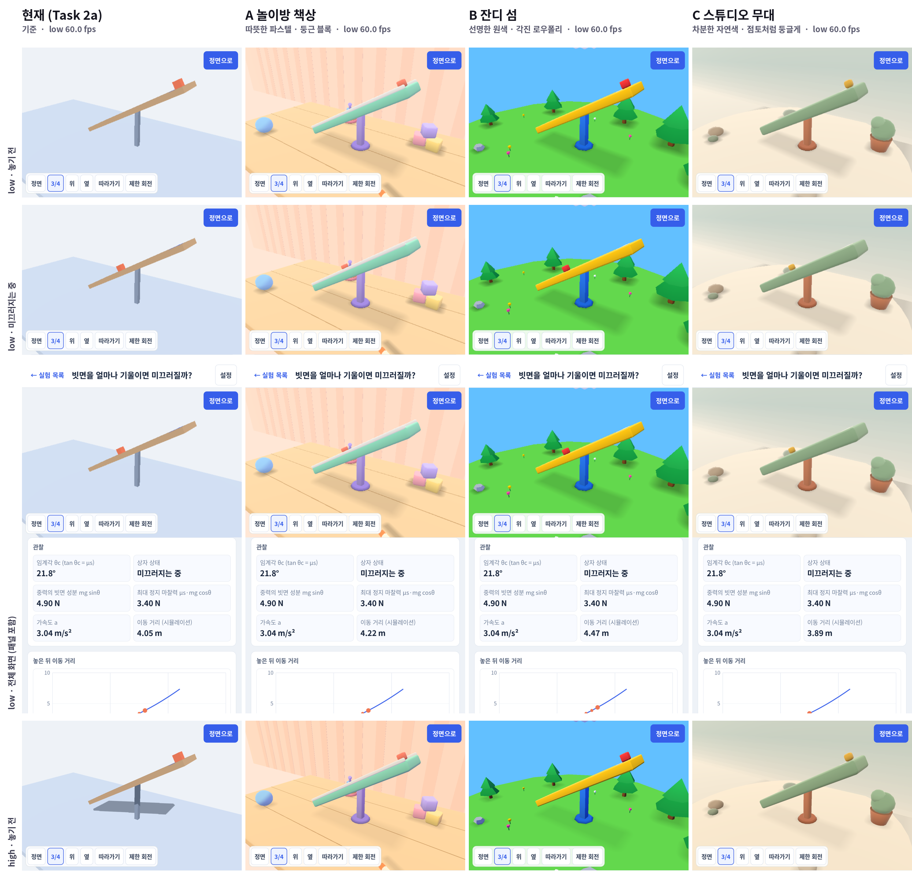
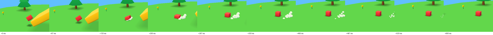

# Phase 1 Task 2c 스타일 시안 (1단계)

- 일시: 2026-10-22, 기기 SM-P200(1200×1920, Mali-G71 MP2), release APK, 세로, 카메라 3/4, 빗면 30°·나무
- 계약: [Phase 1 Task 2c](../../../../../docs/3d-phase1/README.md#task-2c-상세). 이 단계는 고르기 위한 시안까지다. 확정·스타일 가이드·정식 측정은 사용자 선택 뒤에 한다.
- 실행(시안 당시 커밋 `4985e91`에서만): `--style=a|b|c` (없으면 Task 2a 모습). 확정 단계에서 B를 기본으로 하고 이 인자와 A·C 코드는 지웠다([확정 결과](../README.md)). 예: `adb shell am start -n org.openphysics.lab3d/com.godot.game.GodotAppLauncher --es opargs "--experiment=incline-friction,--quality=low,--style=b"`
- 코드: `apps/lab3d/scripts/art/` (`toy_style.gd` 시안 정의·장면 꾸미기, `toy_mesh_builder.gd` 절차적 메시, `toy.gdshader` 구운 조명, `toy_juice.gd` 연출·블롭 그림자)

## 시안

| 시안 | 의도 | 색 | 형태 | 배경 | 그림자 |
|---|---|---|---|---|---|
| A 놀이방 책상 | 집 책상 위 장난감 놀이. 가장 아늑하다 | 따뜻한 파스텔(민트 빗면, 코랄 상자, 라일락 받침) | 중간 둥글림, 빗면에 흰 난간(미끄럼틀) | 나무 책상, 쌓기 블록·링 쌓기·공·크레용, 줄무늬 벽 | 부드럽고 넓게 |
| B 잔디 섬 | 게임 같은 야외 맵. 가장 선명하고 "게임" 느낌이 강하다 | 선명한 원색(노랑 빗면, 빨강 상자, 파랑 받침), 하늘색 배경 | 각진 로우폴리(면마다 한 색, 모서리 깎기만) | 떠 있는 잔디 섬, 나무·바위·꽃·구름 | 진하고 경계가 분명 |
| C 스튜디오 무대 | 박물관 모형처럼 차분. 실험 대상에 시선이 모인다 | 차분한 자연색(세이지, 테라코타, 머스터드) | 크게 둥글린 점토 느낌 | 이음매 없는 배경막과 원형 무대, 화분·조약돌 | 가장 옅고 넓게 |

공통:
- 지오메트리는 모두 코드로 만든다(`ToyMeshBuilder`: 둥근 상자, 원기둥·원뿔, 로우폴리 구, 배경막 스윕). 외부 에셋 없음.
- 조명은 셰이더에서 계산한다(밝은 면/그늘 두 색 램프 + 위쪽 채움 + 테두리광). 엔진 조명·실시간 그림자를 쓰지 않아 low(Compatibility)와 high(Mobile)가 같은 모습이다. high 사진이 low와 거의 같은 이유다.
- 입체감은 정점색 AO(물체 아랫부분을 어둡게)와 블롭 그림자(반투명 원판)로 낸다. 상자 그림자는 매 물리 스텝 아래로 광선 하나를 쏴서 빗면·바닥 어디든 따라간다. 빗면 그림자는 각도에 맞춰 길이가 바뀐다.
- 장식 전체가 메시 하나·그림자 메시 하나라 드로우콜은 기준보다 4개 늘었다(132 → 136).
- 바뀌지 않는 것: 물리 바디·충돌 모양·공식 보정·표시 수치. 빗면은 보이는 두께만 아래쪽으로 늘렸다(윗면은 충돌 면과 같은 위치). 비교 시트 3행의 관찰값(임계각 21.8°, 4.90 N, 3.40 N, 3.04 m/s²)이 네 열에서 같다. 헤드리스 테스트 `apps/lab3d/tools/build.sh test` PASS.
- Compatibility 렌더러는 unshaded ALBEDO를 sRGB로 바꾸지 않고 내보내 색이 짙게 나왔다(실기기에서 확인). 셰이더가 `OUTPUT_IS_SRGB`일 때 직접 변환한다.

## 연출 맛보기 (세 시안 공통, 보이는 메시만)

놓으면 위로 늘어났다 돌아오고, 바닥에 떨어지면 낙하 속도만큼 납작해지며 먼지 알갱이가 퍼지고, 멈출 때 한 번 흔들린다. 처음으로 돌리면 작게 시작해 튀어나온다(pop). 스프링 2개와 CPUParticles3D 하나(한 번에 8–16개)다.

- 위: B 시안, 35° 나무, 따라가기 카메라, 15 fps 연속 장면(착지 +133–200 ms에 납작해짐, 먼지 0.5초). 영상: [juice-b.mp4](juice-b.mp4)(7초, 놓기 → 미끄러짐 → 착지 → 다시 놓기)
- 기본 카메라 거리(11 m)에서 0.4 m 상자의 스쿼시는 작게 보인다. 확정 단계에서 과장 폭·카메라 미세 반응을 정한다.

## fps (짧은 확인, 정식 측정 아님)

`spikes/bench/godot-variant.sh`, low, 20초 대기 후 60초, 측정 기준 조건(패널 관찰값·그래프 위치, 30°, 4초마다 다시 놓기). 원본: [`fps/`](fps/)

| 변형 | FPS | 최저 1초 창 | p95 ms | GPU MHz | 물리 ms | 렌더 CPU ms | 드로우콜 | 프리미티브 |
|---|---|---|---|---|---|---|---|---|
| 기준(Task 2a) | 60.0 | 59.4 | 18.6 | 448 | 3.5 | 4.4 | 132 | 12k |
| A 놀이방 책상 | 60.0 | 59.7 | 19.4 | 513 | 3.6 | 4.4 | 136 | 17k |
| B 잔디 섬 | 60.0 | 59.7 | 19.2 | 486 | 4.1 | 4.4 | 136 | 15k |
| C 스튜디오 무대 | 60.0 | 59.8 | 18.6 | 492 | 4.1 | 4.4 | 136 | 15k |

- 세 시안 모두 60초 동안 60 fps. 평균 GPU 클럭은 기준보다 40–65 MHz 높아 GPU 여유가 조금 줄었다(배경까지 칠하는 면적이 늘어난 몫으로 추정). A가 가장 높다(벽 줄무늬·책상 위 겹침).
- 10분 지속·90초 × 3회는 선택안으로 다음 단계에서 잰다.

## 파일

- `compare.png` 비교 시트(열: 기준·A·B·C, 행: low 놓기 전 / low 미끄러지는 중 / low 전체 화면 / high 놓기 전)
- `raw/<base|a|b|c>-<low-ready|low-sliding|high-ready>.png` 원본 스크린샷(1200×1920)
- `juice-b-landing.png`, `juice-b.mp4` 연출
- `fps/low-<변형>.log|.clk` OPBENCH/OPPERF 로그와 Mali 클럭·AP 온도
